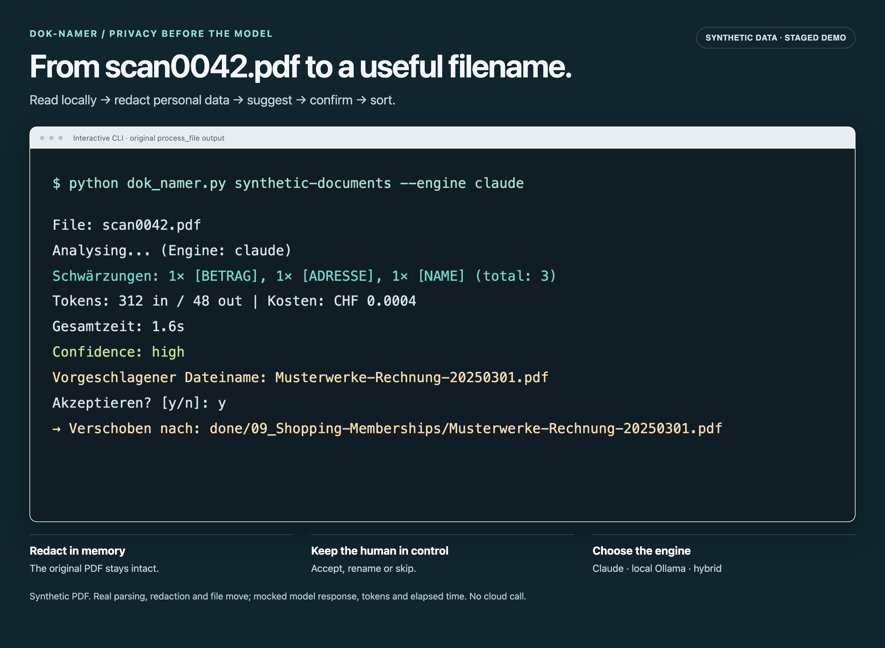

# dok-namer


Renames scanned PDFs with AI. Personal data is redacted in memory before any cloud call, and the `ollama` engine runs entirely on your machine.

> **About this repository:** Public, sanitised version of a private working repo that the author uses on real personal correspondence (tax, banking, insurance). The code is the same apart from anonymised strings; this repo ships with a synthetic test set instead of real PDFs. Synced automatically after every push to the private repo.



*CLI demo using a synthetic PDF and a mocked model response. PDF parsing, redaction, confirmation and moving are real; tokens and time are fixtures. [Visual provenance](docs/hero-visual.md).*

---

## The problem

Scanned documents pile up with names like `scan0042.pdf`, `document_final_v3.pdf`, or whatever your scanner defaults to. Finding a letter from three years ago means opening every file one by one.

The obvious fix is to send each document to an AI and ask for sender, date and topic. The catch: personal documents contain names, IBANs, AHV numbers, addresses, account numbers, and medical information. Sending that to a cloud API is a privacy risk that stops most people from automating this.

dok-namer analyses your PDFs, suggests structured filenames and sorts the files into topic folders. Raw personal data never goes to the cloud.

---

## How it works

dok-namer reads each PDF, strips all personally identifiable information before any cloud call, then uses an AI to extract the document's sender, content type, and date. The result is a clean, searchable filename like:

```
Swisscom-Rechnung-20250301.pdf
```

Documents are then automatically sorted into topic folders under `done/`.

Three engines are available depending on your privacy and performance requirements:

| Engine | How it works | Best for |
|--------|-------------|----------|
| `claude` | Regex redaction in memory, then Claude Haiku | Fastest; reliable for structured PII |
| `ollama` | Fully local via llava, no cloud calls | Maximum privacy; slower |
| `hybrid` | Local LLM anonymises first, regex verifies, then Claude | Highest confidence for mixed documents |

### Interactive workflow

In the default interactive mode, you confirm each rename before it happens:

```
File: scan0042.pdf
  Analysing... (Engine: claude)
    Schwärzungen: 2× [NAME], 1× [IBAN] (total: 3)
  Tokens: 312 in / 48 out  |  Kosten: CHF 0.0002
  Gesamtzeit: 1.6s
  Vorgeschlagener Dateiname: Swisscom-Rechnung-20250301.pdf
  Confidence: high
  Akzeptieren? [y/n]: y
  → Verschoben nach: done/05_Housing-Utilities/Swisscom-Rechnung-20250301.pdf
```

Some console labels are in German (the tool was built for Swiss correspondence). You can accept the suggestion, type a custom filename stem, or skip the file.

---

## Privacy architecture

### The trust problem

Cloud models do this extraction well, but personal documents contain names, IBANs, social security numbers, addresses, and medical details. Even if an API provider promises not to store data, the safest approach is to ensure that sensitive data never leaves your machine in the first place.

### How the redaction pipeline works

Before any text reaches a cloud API, dok-namer applies a multi-layer redaction pipeline entirely in memory:

**Step 1: text extraction**
pypdf extracts text from the PDF locally. The original file is never modified.

**Step 2: regex redaction (always applied)**
A set of compiled regex patterns strips structured PII from the extracted text, replacing each match with a labelled placeholder:

| Pattern | Replaced with |
|---------|--------------|
| IBAN (Swiss and international) | `[IBAN]` |
| Swiss AHV social security number (dotted and 13-digit form) | `[AHV]` |
| Email addresses | `[EMAIL]` |
| Swiss and international phone numbers | `[TELEFON]` |
| Amounts with currency symbols (CHF, EUR, USD) | `[BETRAG]` |
| Swiss postal addresses | `[ADRESSE]` |
| Academic and medical titles + names (Dr., Prof., etc.) | `[BEHANDLER]` |
| Salutation + capitalised words (Herr/Frau/Familie …) | `[NAME]` |
| Recipient-name lines directly above a redacted address | `[NAME]` |
| Dates of birth with a label (Geburtsdatum, geb., Date of Birth …) | `[GEBURTSDATUM]` |
| Credit card numbers (Luhn-valid) | `[KARTE]` |

An optional personal blocklist (`redact-names.txt`) handles names that regex cannot catch: one name per line, case-insensitive. The `claude` engine applies it after the regex pass; the `hybrid` engine applies it to the raw text before the local LLM sees it.

**Step 3: cloud call (with redacted text only)**
Only the redacted text, which contains none of the original PII, is sent to Claude Haiku. The API extracts sender, content type, date, and confidence level as structured output.

**Step 4: exit lock (last hard check before sending)**
`ausgangssperre.py` checks the final message right before `client.messages.parse`, independently of the redaction: AHV numbers, IBANs (valid check digit), Luhn-valid card numbers, labelled dates of birth, API keys (including the value of `ANTHROPIC_API_KEY`) and an optional local deny list (`ausgangssperre.local.yaml`, git-ignored; template `ausgangssperre.example.yaml`). Only text blocks may leave the machine; images or PDFs are always blocked because their content cannot be checked. A hit means the redaction failed: nothing is sent, the file stays unrenamed in `error/`, and the message names only the kind of finding, never the value. A test ensures `analyze_claude` is the only place that talks to the Anthropic client.

### Hybrid mode: defence in depth

The `hybrid` engine adds a local LLM pass before the regex verification:

1. llama3.2 reads the raw text and replaces names and identifiers with placeholders
2. Regex verification checks whether any AHV numbers or Swiss mobile numbers survived the LLM pass
3. Only if the text is clean does it proceed to Claude Haiku

This two-pass approach catches PII that neither regex alone nor an LLM alone would reliably handle.

### Scan PDFs never go to the cloud

If a PDF contains no extractable text (a scanned image with no OCR layer), the redaction pipeline has nothing to work on. The `claude` engine therefore routes the file to `review/` for manual handling without any cloud call; the `ollama` engine reads it locally with llava; the `hybrid` engine stops with an error and moves the file to `error/`.

### Privacy by test

`tests/test_privacy_gate.py` checks the promise at the exit point. A recording fake client stands in for the Anthropic API, and every assertion looks at what would actually have been sent:

- `claude` engine: names, address, AHV number, IBAN, phone, email, amount and a doctor's name from a synthetic letter never appear in the payload; sender and date do
- names from `redact-names.txt` never reach the cloud
- a PDF without a text layer is never uploaded and lands in `review/`
- `hybrid` engine: a no-op or truncated llama3.2 pass stops before the cloud; what llama3.2 misses is caught by the regex pass after it; a residual AHV number stops the file even if that pass fails
- `--eval` never calls Claude on a corpus that is not marked `cloud_safe`
- `tests/test_ausgangssperre.py`: the exit lock stops a payload with leftover PII or a non-text block before the client is called, and no code path other than `analyze_claude` reaches the Anthropic client

The tests run offline in CI before every sync to this repository.

### The original file is never modified

Redaction happens in memory, on the extracted text only. The source PDF is read once, then either moved to its destination folder or left in place. Its contents are never altered.

---

## Output structure

After processing a folder, files are organised as follows:

```
your-documents/
├── done/
│   ├── 01_Taxes-Government/
│   ├── 02_Banking-Pension/
│   ├── 03_Health-Insurance/
│   ├── 04_Insurance/
│   ├── 05_Housing-Utilities/
│   ├── 06_Work-Income/
│   ├── 07_Children-Education/
│   ├── 08_Transport/
│   ├── 09_Shopping-Memberships/
│   ├── 10_Personal-Legal/
│   └── 99_Other/
├── unrecognized/    # low-confidence extractions — review manually
├── review/          # needs manual check (scan PDFs, uncertain PII, failed plausibility check)
└── error/           # technical failures — see dok-namer-log.jsonl
```

Categories are assigned by matching the suggested filename against keyword rules, without an additional API call.

The category system is customisable via a `categories.yaml` file (see [Usage](#usage)).

### Plausibility check before renaming

Models almost always report `high` confidence, even when a field is wrong. Before a file is renamed, dok-namer checks the suggestion locally, without an API call, against the text the model actually saw:

- the date must be a real calendar date in a plausible range and must appear in the text; if the letterhead has a date line, it must be that date (not a due date or period end)
- at least half of the sender's words (ignoring legal suffixes such as AG/GmbH) must appear in the text; a sender that is just the document type is rejected
- at least half of the content label's words must appear in the text, which catches misspelled labels

If a check fails, the file is not renamed: in `--auto` mode it goes unchanged to `review/`, and the log records the suggested name and the reason (`review_reason`). `--eval` reports how many wrong names the check stops and how many correct ones it holds back.

### Consistent sender spellings

Models write the sender freely, so the same company can end up in three spellings. Before renaming, dok-namer maps the model's sender onto a spelling that already exists below `done/`, ignoring case, umlaut spelling, separators and legal or country suffixes; the most frequent existing spelling wins. The matching is purely local; the list of filed senders is never sent to a model. Senders that differ by more than spelling (abbreviation vs. full name) can be pinned in an `absender.yaml` (`--senders <path>`), which takes priority. `--no-sender-matching` keeps the model's sender unchanged.

---

## Setup

```bash
python -m venv .venv && source .venv/bin/activate
pip install -r requirements.txt
export ANTHROPIC_API_KEY=sk-ant-...

# For hybrid or ollama engines:
ollama pull llama3.2
ollama pull llava
```

---

## Usage

```bash
# Folder mode only — to process a single file, place it in a folder

# Folder — interactive (confirms each rename)
python dok_namer.py /path/to/pdfs

# Folder — unattended batch, 4 parallel workers (fastest)
python dok_namer.py /path/to/pdfs --engine claude --auto --workers 4

# Fully local — no cloud calls at all
python dok_namer.py /path/to/pdfs --engine ollama --auto

# Hybrid — local LLM anonymisation + cloud extraction
python dok_namer.py /path/to/pdfs --engine hybrid --auto

# Custom categories
cp categories.yaml.example categories.yaml
# edit categories.yaml to match your document types, then:
python dok_namer.py /path/to/pdfs --config categories.yaml
```

### Resumability

Every processed file is logged to `dok-namer-log.jsonl` in the source folder. If a run is interrupted, re-running the same command picks up where it left off; files already processed and moved are skipped.

### Rate limits and retries

Temporary Claude API errors (rate limits, timeouts, overload) are retried automatically with exponential backoff before a file is routed to `error/`.

---

## Evaluation

`--eval` scores the extracted sender, content type and date against the expected values of the 20 synthetic test PDFs. Latest run (2026-11-17, Apple Silicon, `python dok_namer.py --eval --eval-corpus test-scans --eval-models llama3.2`):

| Model | Sender | Content | Date | All fields | Errors | Avg time |
|-------|--------|---------|------|------------|--------|----------|
| `llama3.2` (local, ollama) | 80% | 75% | 95% | **60%** | 0 | 19.3 s |
| Claude Haiku (`claude` engine) | not measured yet | | | | | |

Confidence calibration for the same run: llama3.2 rated all 20 files `high`, and 60% of those were fully correct. Low confidence routes a file to `unrecognized/` instead of renaming it, but that safeguard only helps when the model admits uncertainty, which llama3.2 did not do here. The numbers come from a synthetic corpus and say nothing about real correspondence.

To reproduce:

```bash
pip install -r requirements.txt reportlab
python generate_test_pdfs.py
python dok_namer.py --eval --eval-corpus test-scans --eval-models llama3.2   # add --eval-claude for Claude Haiku
```

---

## Tech stack

- **Python 3.11+** (CI runs on Python 3.15): single-file script, no package structure required
- **Claude Haiku** (`claude-haiku-4-5-20251001`) via the Anthropic API; structured output through Pydantic models and `client.messages.parse()`
- **llava + llama3.2** via Ollama (optional: llava for the fully local `ollama` engine, llama3.2 for `hybrid` anonymisation and `--eval`)
- **pypdf**: PDF text extraction
- **pyyaml**: configurable category system
- **pytest**: offline test suite, including the privacy gate (`tests/test_privacy_gate.py`)

---

## Performance

Benchmark run by the author on Apple Silicon with 20 test PDFs (single measurement, not part of the test suite):

| Configuration | Total | Per file | Notes |
|---------------|-------|----------|-------|
| `--engine hybrid --workers 1` | 190 s | 9.5 s | Baseline |
| `--engine hybrid --workers 4` | 640 s | 32 s | Ollama serialises internally; parallel calls queue up |
| `--engine claude --workers 4` | **33 s** | **1.7 s** | Best throughput |

Key insight: Ollama serialises all requests per model. Multiple parallel llama3.2 calls queue internally and are slower than sequential. Parallel Claude calls scale well because the API handles concurrency server-side.

Projected throughput: 400 PDFs at 1.7 s/file across 4 workers ≈ **~170 seconds (~3 minutes)**.

---

## License

Licensed under the [MIT License](LICENSE).

Contributions welcome: open an issue or a pull request.
